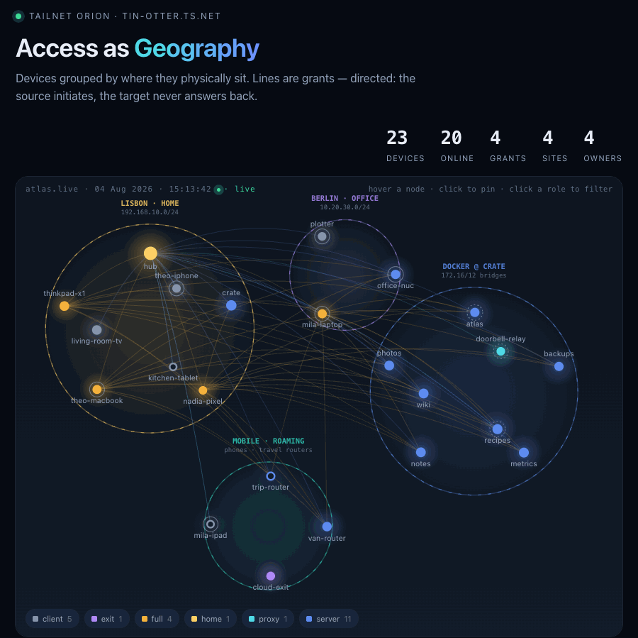

# Tailnet Atlas

A live map of your tailnet that answers one question: **who can actually reach what?**

It reads your device list and your policy file from the Tailscale API and draws
them as one picture — devices grouped by where they physically are, lines taken
straight from your grants.

### ▶ [Try the live demo](https://crazyhoesl.github.io/tailnet-atlas/)

Hover the nodes, click one to pin it, click a role in the legend to filter.



*Everything in the demo and the recording is invented — fake devices, users,
sites and networks — but it is rendered by the real code, not mocked up. You
can regenerate it yourself, see [Demo](#demo).*

---

## What it shows

* **Devices are grouped by where they physically are**, not by role. The region
  a node lands in comes from the address it was last given by the network it
  joined. Nothing is hand-assigned: a phone that comes home moves out of
  "roaming" into the home cluster on the next refresh.
* **Lines are grants** from your policy file, and they are directional — the
  source initiates, the target never answers back. Particles flow the way
  access does.
* **Hover a node** for its site, Tailscale IP, local address, OS, owner,
  advertised routes, tags, and how many nodes it reaches / is reached by.
* **Click to pin** and everything unrelated dims — the view worth having open
  while you are about to change a grant.
* **Devices with a web UI open on click.** A node that answers on 443 gets a
  ` ↗` and opens `https://<its MagicDNS name>/` in a new tab instead of
  pinning. The check runs in *your* browser, not on the server: the Atlas
  node itself usually may not reach other devices, and what matters is
  whether the person looking can open the page. Off in the demo, because
  invented `*.ts.net` names may belong to a real tailnet.
* **The legend doubles as a role filter.**
* Tables below the map for devices, grants, sites and owners, plus one that
  documents the placement rules. That table is generated from the same
  constants the placement code uses, so it cannot drift from the behaviour.

## The bit that was harder than expected

Locating a device sounds trivial and isn't. Tailscale reports *every* interface
a device has: container bridges, VM adapters, and — worst — travel routers that
hand out their own LAN and carry it everywhere. Grouping on "has a 192.168.8.x
address" puts your travel router at home while it is sitting in a hotel.

The rule that works:

> **Whoever hands out a network holds the `.1` in it.**

So drop those addresses and keep the one the device was *given*. That is its
uplink, and that is where it actually is. Pleasant side effect: a Docker host
stops showing a bridge address and shows its real LAN IP instead.

Deliberately **not** done via the device's advertised routes — a subnet router
that merely *joined* the network it announces holds a normal host address in
it, and that test would strip its real address. The gateway convention
separates "I created this network" from "I joined this network" exactly.

One trap if you build something similar: a phone hotspot hands out
`172.20.10.x`, which sits inside `172.16/12` and otherwise reads as a container
bridge. Rule order matters, which is why it is explicit in the config.

## Running it

You need a Tailscale **OAuth client** (read-only is enough: `devices:core:read`
and `policy_file:read`) and a **tagged** auth key for the node itself.

```bash
git clone https://github.com/crazyhoesl/tailnet-atlas
cd tailnet-atlas
cp .env.example .env                  # OAuth client + auth key + node name
cp config.example.toml config.toml    # your sites and networks
docker compose up -d --build
```

Then open `https://<TS_HOSTNAME>.<your-tailnet>.ts.net`.

The app binds `127.0.0.1` inside the Tailscale sidecar's network namespace and
is reachable only through `tailscale serve`. Funnel is explicitly disabled in
`serve.json`. It only ever reads from the API.

### Configuration

Everything specific to your setup lives in `config.toml`; see
[`config.example.toml`](config.example.toml), which is commented in full. In
short: one `[[site]]` block per place, each with an address prefix that places a
device there. Two site ids are reserved — `dock` takes whatever is left inside
`172.16/12`, and `mobile` is the fallback for anything that matched nothing.

Positions (`fx`/`fy`) are only a starting hint. The layout pushes overlapping
regions apart and keeps them inside the frame, and on narrow screens it stacks
them in a single column, so you do not have to get them right.

### Refresh behaviour

A background loop rebuilds every 5 minutes. While the page is open it also
polls every 10 seconds for up to 5 minutes of *viewing* time — a backgrounded
tab never polls. The server coalesces those requests behind a short TTL, so ten
open tabs still mean one call upstream. What is served is always the last
successfully built version; if the API goes down the page keeps working and
grows a "stale" banner.

## Demo

No credentials needed — this pushes fictional devices through the real
rendering code, so it is the actual product with different input:

```bash
python3 demo/make_demo.py
open demo/out/atlas-demo.html
```

`demo/out/atlas-demo.html` is a single self-contained file you can open from
disk. The same build is written to `docs/index.html`, which is what GitHub
Pages serves as the [live demo](https://crazyhoesl.github.io/tailnet-atlas/) —
so regenerating and committing keeps the hosted page in step.

To re-record the GIF:

```bash
cd demo && npm install
DUMP=1 node record.js && node verify.js
```

`record.js` drives a real cursor with Puppeteer. `verify.js` decodes the
finished GIF with disposal applied and compares frames against the source PNGs
— the inter-frame diffing that gets the file from 22 MB down to 7 MB is exactly
the kind of optimisation that breaks silently.

`demo/geotest.js` replays the layout maths against a rendered page and checks
for overlapping nodes, colliding labels and regions leaving the frame — across
four window sizes and four different device distributions. Worth running after
touching anything in the layout.

## Status

Shared as-is because people asked for it, not as a maintained project. It works
on my setup; it may need adjusting for yours. No support, no roadmap, and I
probably will not review pull requests promptly — but the code is yours to take
in whatever direction you like.

## License

MIT
